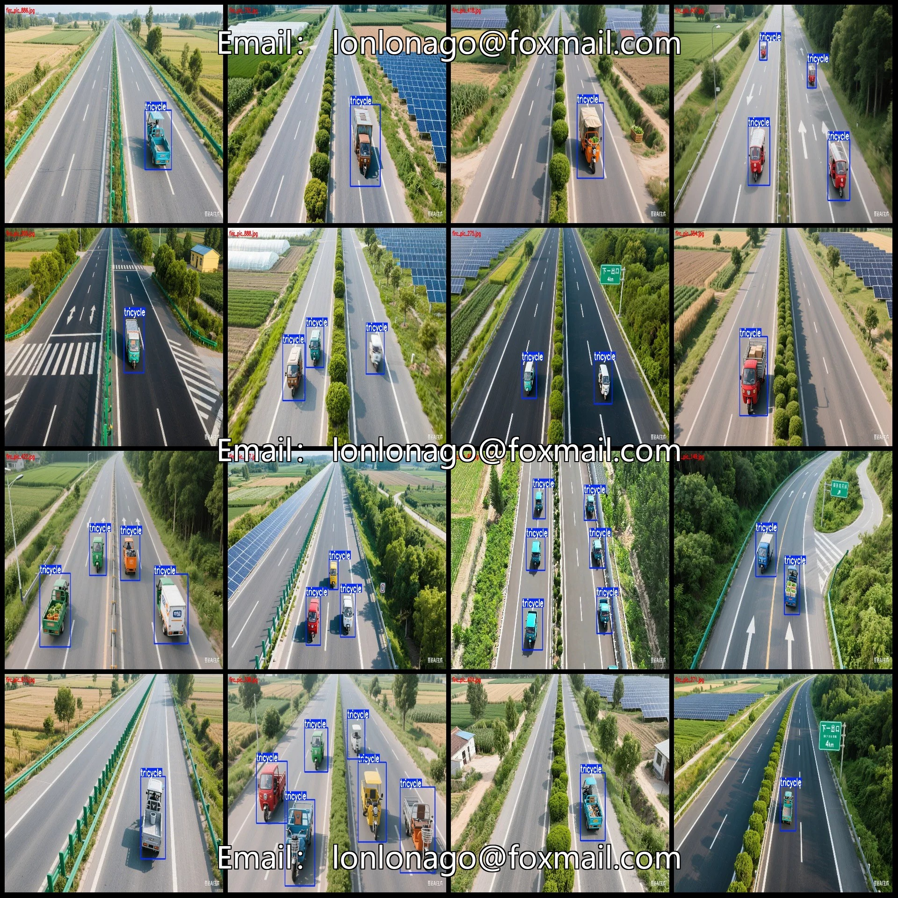
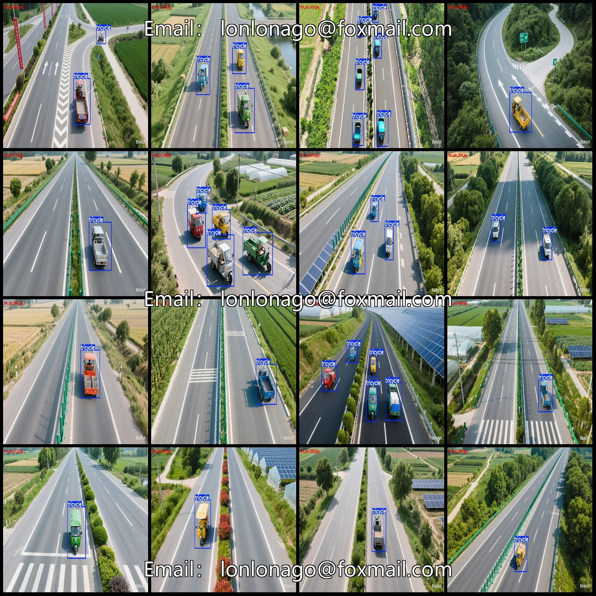
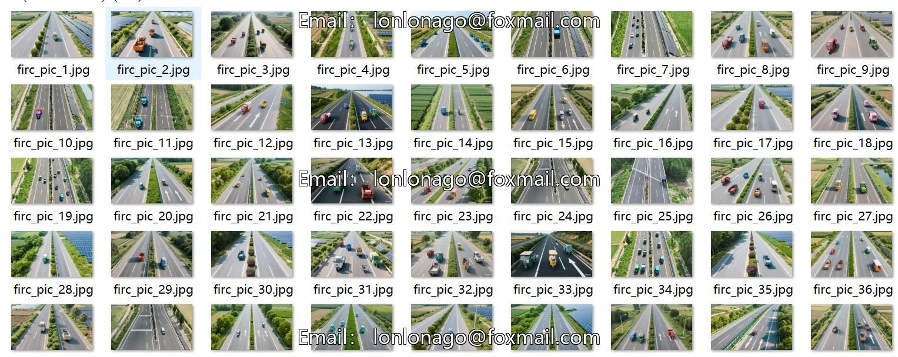
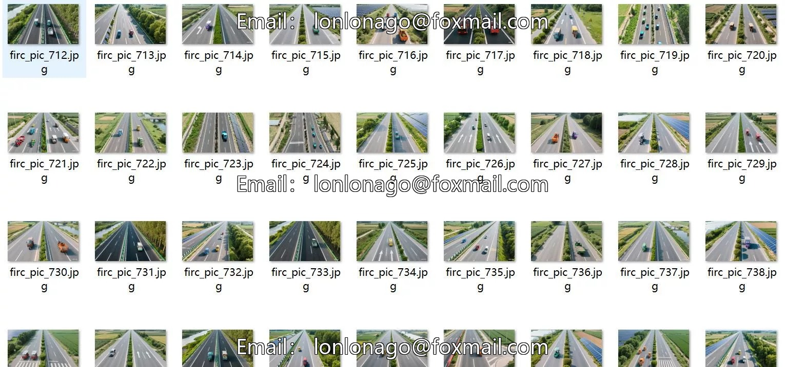
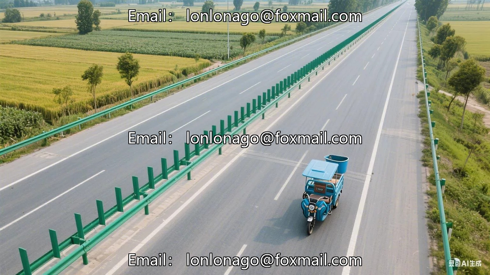

# Drone-view aerial photography dataset of highway inspection for tricycles in VOC+YOLO format

## Body

Drone-view aerial photography dataset for detecting tricycles on highways in VOC+YOLO format with 976 images in one category
Warm reminder: Due to the dataset's replicability, please confirm compliance before purchasing.
Dataset format: Pascal VOC format + YOLO format (txt file without split path, only contains jpg images and corresponding VOC format xml files and yolo format txt files)
Number of images (number of jpg files): 976
Number of annotations (number of xml files): 976
Number of annotations (number of txt files): 976
Label category count: 1
Annotation category name: ["tricycle"]
Number of boxes labeled in each category

Tricycle Frame Count = 2985
Total Frame Count: 2985
Number of Images per Category
Tricycle Contains: 976 Images
Image Resolution: 1536x864
Labeling Tool: labelImg
Labeling Rules: Draw a rectangle around the category.
Important Note: The dataset does not have separate training, validation, or test sets; you need to partition them yourself.
Special Remarks: This dataset does not guarantee the accuracy of the trained models or weight files.

## Images

## Payment

Here is a pay link on Stripe ( https://buy.stripe.com/3cs8yP7sY87d0vu9AB ). Please contact me lonlonago@foxmail.com after funding $89, and I will send you a complete data files , thank you!

